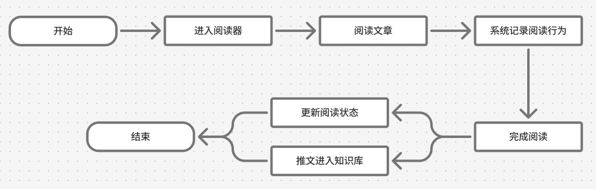
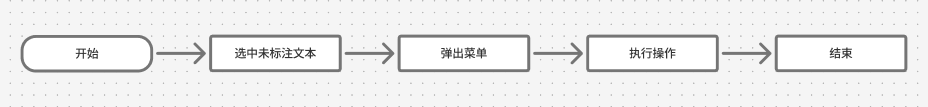
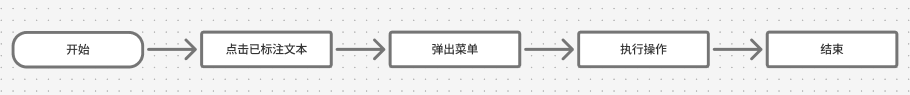
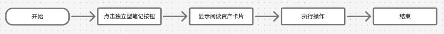
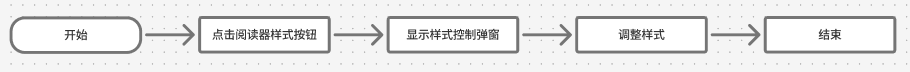
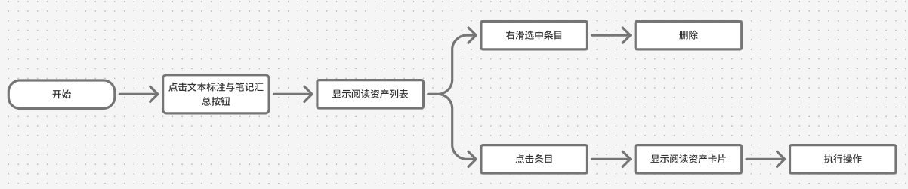
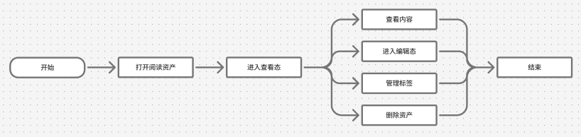
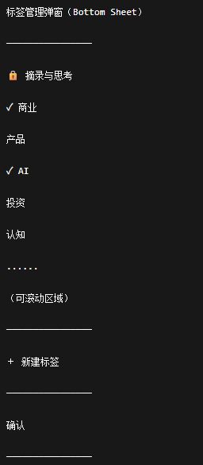
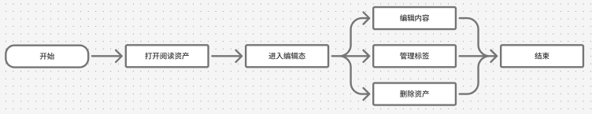

产品定位
本产品面向在AI时代下正在经历FOMO（错失恐惧症）的人群，针对这一人群因接收信息过载导致心理焦虑，想要在海量碎片信息中提升认知却无从下手，在社媒收藏内容但“只藏不看”等痛点；以及渴望提升自我认知这一痒点，设计一款每日内容推送形式的AI深度阅读平台，为目标人群搭建一个从高质量信息摄入到获得即时成就感的情绪闭环

产品能让用户在阅读行为中获得足够的情绪价值，让用户能即时地感知到“自己正在变得更好”这一爽点，从而使本产品在阅读类产品中有较高的用户留存率
产品能通过AI伴读的形式帮助用户尽可能轻松地理解内容，解决阅读过程中产生的疑问，接住阅读过程中产生的想法，实现知识沉淀
产品能提供一个统一管理推送内容、用户输出内容、以及各大社媒收藏内容的AI个人知识库，使知识资产可视化，缓解“读了就忘”的焦虑情绪，同时降低回找知识的时间成本

需求分析
分析一下近几年的网络环境，焦虑来源，焦虑人群表现；竞品调研：竞品在市场上的表现，目标人群的付费意愿；知识付费这条赛道近几年的增长变化

业务规则（系统怎么处理数据，一旦改变，会影响多个页面和整个数据模型的规则）
1. 内容对象规则
- 核心对象
系统存在两类核心内容对象：推文和阅读资产。
推文是由服务器推送产生的完整文章，是阅读流和知识库的核心内容来源。
阅读资产是用户在阅读过程中产生的认知沉淀，包括纯划线、关联型笔记和独立型笔记，三者统一作为阅读资产进行管理。
- 同一对象原则
系统中的内容对象始终只有一个业务实体，两类对象在不同的模块中以不同的形式呈现，但数据结构唯一：
推文 = 唯一文章实体
阅读资产 = 唯一用户认知实体
所有列表、入口、搜索结果均为同一数据实体的不同视图，不产生副本。
- 对象关系模型
以下为对象的组织方式，不产生独立副本。
推文关系
推文 ↔ 合集（多对多关系）
阅读资产关系
阅读资产 ↔ 标签（多对多关系）
阅读资产 ↔ 推文（多对一关系）
- 对象展示视图
以下为对象的展示视图，不产生独立副本，只负责展示和跳转。
推文视图：
每日好文卡片
往期推文条目
合集内推文条目
搜索结果卡片（推文）

阅读资产视图：
摘录与思考内阅读资产条目
标签内阅读资产条目
本文标注与笔记汇总内阅读资产条目
搜索结果卡片（阅读资产）

2. 保存位置规则
系统中的内容对象均遵循“系统保底保存 + 用户主动组织”的原则。
推文的系统保底保存位置为「往期推文」，用户主动组织位置为「合集」。
阅读资产的系统保底保存位置为「摘录与思考」，用户主动组织位置为「标签」。

3. 推文规则
- 规则一
服务器向客户端推送文章后，系统自动将文章加入阅读流，并同步保存至知识库的「往期推文」。
推文对象不可被删除，所有推送文章永久存在于「往期推文」中，用户不能将文章从「往期推文」中删除。
- 规则二
推文具有阅读状态。MVP阶段包含“未阅读”、“阅读中”（已开始阅读还未完成阅读）、“已完成阅读”三种状态。用户开始阅读、完成阅读后，仅更新阅读状态，不影响文章在「往期推文」中的保存状态。
- 规则三 阅读位置恢复规则
系统持续记录用户的阅读进度。推文阅读状态为“阅读中”时，再次进入阅读器应恢复上次阅读位置。
推文阅读状态为“未阅读”或“已完成阅读”时，进入阅读器均从文章开头开始阅读。

4. 阅读资产规则
用户创建划线或笔记后，系统生成阅读资产。
阅读资产为统一实体 `ReadingAsset`，根据划线与笔记字段的状态分为三种业务形态：
- 纯划线 `highlight_only`：存在划线内容与划线位置，不存在笔记内容。
- 关联型笔记 `linked_note`：存在划线内容与划线位置，同时存在笔记内容。
- 独立型笔记 `standalone_note`：存在笔记内容，不存在划线内容与划线位置。

纯划线与关联型笔记属于同一种带划线阅读资产，使用同一张阅读资产卡片展示。卡片上方展示划线内容，下方展示笔记区域。
用户为纯划线填写笔记内容后，该阅读资产变更为关联型笔记；用户清空关联型笔记的笔记内容后，该阅读资产变更为纯划线。上述变化不创建新的阅读资产，也不影响原有划线内容。
独立型笔记为不绑定具体原文片段的阅读资产，UI上仅展示笔记内容。
删除带划线阅读资产时，系统同时删除该资产中的划线内容与笔记内容；删除独立型笔记时，系统删除该独立型笔记资产。

阅读资产遵循：系统保底保存+用户主动组织原则。
阅读资产系统保底保存位置为「摘录与思考」，且：必选、锁定、不可取消，所有阅读资产在用户创建时自动进入「摘录与思考」。
标签属于阅读资产主动组织方式，用户可以将阅读资产保存至一个或多个标签。标签是用户主动组织阅读资产的方式。从标签中移除阅读资产时，仅取消该标签中的保存位置，不影响阅读资产本身。
纯划线、关联型笔记、独立型笔记均与创建时所在文章建立永久关联关系。
阅读资产被归档至摘录与思考或标签后，不影响其与原文章的关联关系。

用户再次打开原文章时：
1、纯划线与关联型笔记对应的划线内容继续以高亮状态展示于正文中；
2、点击已标注文本后，仍可打开对应阅读资产卡片进行查看或编辑；
3、本文标注与笔记汇总页面持续展示该文章下产生的全部纯划线、关联型笔记及独立型笔记；
4、删除标签、调整归档位置、移动至其他合集等操作，不影响阅读资产与原文章的关联关系。

5. 删除规则
推文不支持删除。
用户在「摘录与思考」中删除阅读资产、在阅读资产卡片中点击删除按钮，都视为真正删除。
删除后，系统同步将该阅读资产从所有标签和搜索结果中移除，不再保留该阅读资产的数据记录。
用户在普通标签（除“摘录与思考"外的所有标签）中移除阅读资产时，不视为删除，仅取消当前标签中的保存位置。
用户在普通合集（除“往期推文”外的所有合集）中移除推文时，不视为删除，仅取消当前合集中的保存位置。

6. 阅读资产卡片规则
阅读资产卡片是阅读资产唯一的查看入口和编辑入口。
无论用户从阅读器、摘录与思考、标签还是AI搜索进入阅读资产，均打开同一个阅读资产卡片。
关联型笔记展示对应划线内容。
独立型笔记不展示划线内容。
纯划线展示划线内容，并支持后续添加笔记。
用户可在阅读资产卡片中管理标签，包括添加标签、移除标签和新建标签。
用户不能移除「摘录与思考」这一系统保底保存位置。

7. 标签规则
标签是系统唯一的阅读资产组织视图。
标签不保存内容，不是存放阅读资产的地方，它仅建立阅读资产与标签之间的关联关系，是帮助用户找到阅读资产的方式。
标签在不同模块中的差异仅体现在：
- 创建入口
- 编辑入口
- 浏览入口
- 检索入口
不改变标签本身的数据结构与语义。

8. 搜索规则
AI搜索基于知识库内容进行检索。
检索对象包括：
推文
划线
笔记
知识库主页搜索范围为全部知识库内容。
二级页面搜索范围限定为当前模块内容。
搜索结果中的推文点击后进入阅读器。
搜索结果中的阅读资产点击后打开阅读资产卡片。


<!-- 功能详情（条列式呈现）
1、业务流程（用户完成任务的路径）
2、产品界面流程图/交互原型图
3、页面名称
4、页面入口
5、页面功能
6、页面逻辑及交互说明（用户如何操作）
7、异常事件（Corner Case）说明 -->

<!-- 功能界面
    ↓
业务流程（用户视角）
    ↓
交互原型（界面视角）
    ↓
业务逻辑（系统视角） -->


功能模块
↓
功能
↓
交互流程图
↓
交互原型图
↓
逻辑内容及交互说明


# 1 AI深度阅读器
## 1.0 模块总说明
### 1.0.1 页面名称
阅读器
### 1.0.2 页面入口
- 主页（阅读流）→每日好文
- 知识库→往期推文
- 知识库→推文合集
- AI搜索结果→文章
### 1.0.3 业务规则
- 规则一
文章推送时自动进入知识库-往期推文，阅读完成与否不影响推文的归档状态

## 1.1 完成阅读
### 1.1.1 业务流程图

### 1.1.2 交互原型图
### 1.1.3 逻辑内容及交互说明
#### 1.文章内容渲染展示
基础文本渲染、预设难点文本样式注入
#### 2.阅读行为记录
系统记录阅读总时长、纯划线内容、关联型笔记内容、独立型笔记内容、AI释义/AI提问内容
#### 3.阅读状态管理
文章存在三种状态：
- 未阅读
- 阅读中（已开始阅读还未完成阅读）
- 已完成阅读
用户打开阅读器查看文章后，阅读状态从未阅读切换为阅读中；用户完成阅读后，阅读状态从阅读中切换为已完成阅读
#### 4.完成阅读
用户点击文章末尾的完成阅读按钮视为完成了阅读，这是mvp完成阅读的唯一方式。完成阅读后弹出AI阅读报告弹窗。

## 1.2 未标注文本交互
### 1.2.1 交互流程图

### 1.2.2 交互原型图
### 1.2.3 逻辑内容及交互说明
#### 1.划线
用户选中文本，弹出操作菜单，点击“划线”按钮，选中的文本被高亮，生成纯划线阅读资产
#### 2.打开阅读资产卡片（新建关联型笔记）
用户选中文本，弹出操作菜单，点击“打开阅读资产卡片”按钮，显示阅读资产卡片，进入编辑态，用户可进行编辑笔记内容，添加笔记标签等操作
用户点击完成编辑按钮后，系统创建关联型笔记阅读资产，同时将选中文本变为划线状态，进行高亮标注
#### 3.AI释义
用户选中文本，弹出操作菜单，点击“AI释义”按钮，显示AI伴读弹窗，系统基于选中文本、上下文生成解释内容
#### 4.拷贝
用户选中文本，弹出操作菜单，点击“拷贝”按钮，复制选中文本至系统剪贴板

## 1.3 已标注文本交互
### 1.3.1 交互流程图

### 1.3.2 交互原型图
### 1.3.3 逻辑内容及交互说明
#### 1.取消划线（删除带划线阅读资产）
用户点击划线，弹出操作菜单，点击“取消划线”按钮
系统取消划线（即取消高亮标注），删除该带划线阅读资产，系统同时删除该资产中的划线内容与笔记内容
#### 2.打开阅读资产卡片（查看、新建、编辑关联型笔记）
用户点击划线，弹出操作菜单，点击“打开阅读资产卡片”按钮，显示阅读资产卡片，进入查看态，用户可进行查看、新建、编辑笔记内容，添加、移动笔记标签等操作
#### 3.AI释义
用户点击划线，弹出操作菜单，点击“AI释义”按钮，显示AI伴读弹窗，系统基于划线文本、上下文生成解释内容
#### 4.拷贝
用户点击划线，弹出操作菜单，点击“拷贝”按钮，复制划线文本至系统剪贴板
#### 5.打开标签管理弹窗（查看、添加、编辑标签）
用户点击划线，弹出操作菜单，点击“打开标签管理弹窗”按钮，显示标签管理弹窗，用户可查看、添加、编辑该阅读资产（纯划线/关联型笔记）的标签

## 1.4 独立型笔记
### 1.4.1 交互流程图

### 1.4.2 交互原型图
### 1.4.3 逻辑内容及交互说明
用户点击阅读器左下角“添加独立型笔记”按钮，系统显示阅读资产卡片，进入编辑态，用户可进行编辑笔记内容，添加笔记标签等操作
用户点击完成编辑按钮后，系统创建独立型笔记阅读资产

## 1.5 阅读器样式设置
### 1.5.1 交互流程图

### 1.5.2 逻辑内容及交互说明
字号调整：放大、缩小字号
主题切换：浅色、深色、跟随系统
### 1.5.3 业务规则
- 设置修改后自动保存

## 1.6 文本标注与笔记汇总
### 1.6.1 交互流程图

### 1.6.2 交互原型图
阅读资产条目UI展示信息有：
#### 1. 纯划线
- 划线内容
- 条目底部展示“在文中显示”入口。用户点击后，系统进入该阅读资产关联文章的阅读器，并直接定位至对应的划线区域。
#### 2. 关联型笔记
- 划线内容
- 笔记内容
- 条目底部展示“在文中显示”入口。用户点击后，系统进入该阅读资产关联文章的阅读器，并直接定位至对应的划线区域。
#### 3. 独立型笔记
- 笔记内容
- 不展示“在文中显示”入口。
### 1.6.3 逻辑内容及交互说明
用户点击右上角文本标注与笔记汇总按钮进入该页面，页面显示纯划线、关联型笔记、独立型笔记三类阅读资产的条目
用户点击任意条目，系统打开对应的阅读资产卡片，进入查看态，用户可进行查看，编辑笔记内容，添加、移动笔记标签等操作
用户点击纯划线或关联型笔记条目底部的“在文中显示”入口，系统不打开阅读资产卡片，直接进入该阅读资产关联文章的阅读器，并定位至对应的划线区域。
该操作不是创建新的阅读器页面，而是退出当前的「文本标注与笔记汇总」页面，回到用户从每日推文进入的同一阅读器，并将该阅读器的正文位置更新至对应划线区域。此后用户点击阅读器左上角返回按钮或触发 iOS 返回手势，返回阅读流，不返回「文本标注与笔记汇总」页面；用户需再次点击阅读器右上角汇总入口，才重新进入该汇总页面。
用户右滑任意条目，条目进入选中状态，条目背景颜色加深，底部显示删除按钮，用户点击删除按钮，删除已选中条目，刷新列表
支持同时选中多个目录，用户右滑其他条目，选中数量增加。用户点击删除按钮，删除全部已选中条目，刷新列表
支持取消选中，用户右滑已选中条目，取消选中，背景颜色恢复默认状态。当所有条目均取消选中时，底部删除按钮隐藏

# 2 阅读资产卡片
## 2.0 模块总说明
### 2.0.1 页面名称
阅读资产卡片
### 2.0.2 业务规则
- 规则一
阅读资产卡片是阅读资产唯一查看入口和编辑入口。无论用户从阅读器、知识库还是AI搜索进入阅读资产，均打开同一个阅读资产对象。阅读资产卡片统一承载：纯划线、关联型笔记、独立型笔记的查看、编辑和归档管理能力。
- 规则二
阅读资产卡片包含：查看态、编辑态两种状态。

## 2.1 查看态
### 2.1.1 交互流程图

### 2.1.2 交互原型图

### 2.1.3 页面入口
- 阅读器→点击已标注文本（划线）→显示操作菜单→打开阅读资产卡片
- 阅读器→文本标注与笔记汇总→点击任意条目→打开阅读资产卡片
- 知识库→任意标签（包括摘录与思考）→点击任意条目→打开阅读资产卡片
- AI搜索结果→点击资产卡片
### 2.1.4 逻辑内容及交互说明
#### 1.查看纯划线
卡片顶部划线区域展现划线内容，划线内容被限制在固定高度的方框内。展示当划线内容未超过展示上限时，完整展示；若内容超过展示上限，超出部分不继续显示。用户点击划线内容方框后，进入划线内容详情页，可查看完整划线内容并上下滑动浏览。
卡片正文区域展示“添加笔记内容”提示文案。点击此文案位置将进入编辑态。
#### 2.查看关联型笔记
卡片划线区域展示划线内容，展示规则与纯划线阅读资产一致。
卡片笔记区域展示笔记内容。
#### 3.查看独立型笔记
没有关联的划线内容展示。
仅从卡片顶部开始展示笔记内容。
#### 4.进入编辑态
用户点击右下角“编辑”按钮，系统将卡片切换至编辑态。
用户点击卡片正文区域展示“添加笔记内容”提示文案，系统将卡片切换至编辑态。
#### 5.标签管理（查看态）
用户点击卡片左下角“标签”按钮，系统从底部弹出标签管理 Bottom Sheet
弹窗以单列列表展示标签
- 标签选择与取消选中：
用户点击未选中标签，标签右侧显示勾选标记
用户点击已选中标签，标签右侧勾选标记消失
未选中 → 点击 → 选中
已选中 → 点击 → 取消选中
- 系统保底标签：
「摘录与思考」固定展示在标签列表顶部，默认选中并锁定，勾选标记前有一个锁的标记。
用户不可取消、删除或编辑。
- 标签列表滚动：
当标签数量超出可视区域时，仅标签列表区域支持纵向滚动。
标签列表区域：可滚动
＋ 新建标签：固定底部
确认按钮：固定底部
- 新建标签
用户点击：
＋ 新建标签
后，系统调起键盘。
用户输入标签名称并完成创建后，新标签加入列表，并默认处于选中状态。
- 确认
用户点击：
确认
后，系统立即更新该阅读资产的标签归档状态，并关闭 Bottom Sheet。
#### 6.删除资产
用户点击卡片左下角“删除”按钮，系统弹出确认弹窗：
确认删除该阅读资产？
取消
确认删除
用户点击：
确认删除
后，系统删除当前阅读资产，随后关闭阅读资产卡片，返回打开卡片前所在页面。
#### 7.退出卡片
用户执行以下任意操作：
- 向下拖拽卡片
- 点击卡片外部区域
系统关闭阅读资产卡片。
关闭后：返回打开卡片前所在页面。
### 2.1.5 异常事件（Corner Case）
- 阅读资产不存在
展示：
内容不存在
- 标签更新失败
展示：
标签更新失败
请稍后重试
### 2.1.6 业务规则
- 规则1
查看态标签管理属于：
立即生效模式，用户点击标签管理弹窗的确认按钮后立即更新归档位置，无需进入编辑态。
- 规则2
修改标签不会影响：
阅读资产内容
阅读资产ID
与原文章关联关系

## 2.2 编辑态
### 2.2.1 交互流程图

### 2.2.2 交互原型图
### 2.2.3 页面入口
- 阅读器→选中未标注文本（选中划线）→显示操作菜单→新建关联型笔记
- 阅读器→新建独立型笔记
- 阅读资产卡片查看态→点击卡片正文区域展示“添加笔记内容”提示文案
- 阅读资产卡片查看态→点击卡片右下角编辑按钮
### 2.2.4 逻辑内容及交互说明
#### 1.查看纯划线
和查看态一致，卡片顶部划线区域展现划线内容，划线内容被限制在固定高度的方框内。展示当划线内容未超过展示上限时，完整展示；若内容超过展示上限，超出部分不继续显示。用户点击划线内容方框后，进入划线内容详情页，可查看完整划线内容并上下滑动浏览。
用户进入编辑态时，系统聚焦笔记输入区域，调起系统键盘，用户可编辑内容。
#### 2.编辑关联型笔记
卡片划线区域展示划线内容，展示规则与纯划线阅读资产一致。
用户进入编辑态时，系统聚焦笔记输入区域，调起系统键盘，用户可编辑内容。
#### 3.编辑独立型笔记
没有关联的划线内容展示。
用户进入编辑态时，系统聚焦笔记输入区域（即卡片顶部），调起系统键盘，用户可编辑内容。
#### 4.标签管理（编辑态）
用户点击卡片左下角“标签”按钮，系统从底部弹出标签管理 Bottom Sheet，弹窗结构与查看态一致。
弹窗以单列列表展示标签
- 标签选择与取消选中：
用户点击未选中标签，标签右侧显示勾选标记
用户点击已选中标签，标签右侧勾选标记消失
未选中 → 点击 → 选中
已选中 → 点击 → 取消选中
- 系统保底标签：
「摘录与思考」固定展示在标签列表顶部，默认选中并锁定，勾选标记前有一个锁的标记。
用户不可取消、删除或编辑。
- 标签列表滚动：
当标签数量超出可视区域时，仅标签列表区域支持纵向滚动。
标签列表区域：可滚动
＋ 新建标签：固定底部
确认按钮：固定底部
- 新建标签
用户点击：
＋ 新建标签
后，系统调起键盘。
用户输入标签名称并完成创建后，新标签加入列表，并默认处于选中状态。
- 确认
用户点击 Bottom Sheet 中的“确认”后，系统关闭标签管理弹窗。
此时标签变更仅暂存在当前阅读资产卡片编辑态中，不会立即更新阅读资产归档位置。
用户继续点击卡片右下角“完成编辑”后，系统统一提交笔记内容修改和标签归档修改，并更新阅读资产归档位置。
#### 5.删除资产
用户点击卡片左下角“删除”按钮，系统弹出确认弹窗：
确认删除该阅读资产？
取消
确认删除
用户点击：
确认删除
后，系统删除当前阅读资产，随后关闭阅读资产卡片，返回打开卡片前所在页面。
#### 6.完成编辑
用户完成编辑后，点击“完成编辑”按钮。
系统提交笔记内容修改和标签修改。
保存成功后，关闭阅读资产卡片，返回打开卡片前所在页面。
#### 7.退出卡片
用户执行以下任意操作：
向下拖拽卡片
卡片外部区域
- 情况一：无未保存修改
系统直接关闭阅读资产卡片，返回打开卡片前所在页面。
- 情况二：存在未保存修改
系统弹出确认弹窗：
放弃本次编辑？
继续编辑
放弃编辑
用户点击“继续编辑”，返回编辑态。
用户点击“放弃编辑”后，关闭阅读资产卡片，返回打开卡片前所在页面，本次修改不生效。
### 2.2.5 业务规则
- 规则1
查看态和编辑态使用同一种标签管理 Bottom Sheet 组件。
- 规则2
查看态中，点击 Bottom Sheet 的确认按钮后，标签修改立即生效。
- 规则3
编辑态中，点击 Bottom Sheet 的确认按钮后，标签修改仅暂存；用户点击卡片「完成编辑」后，标签修改才正式生效。
- 规则4
「摘录与思考」为系统保底保存位置，始终选中且不可取消。
- 规则5
标签修改只影响阅读资产的归档位置，不影响阅读资产内容、阅读资产ID、原文关联关系和正文高亮状态。
- 规则6 纯划线归档
用户在阅读器中选中文本后，点击操作菜单的“划线”按钮后，系统立即创建纯划线阅读资产。
创建成功后自动归档至标签：摘录与思考，用户无需执行额外保存操作。


# 3 阅读流
## 3.0 模块总说明
### 3.0.1 页面名称
阅读流
### 3.0.2 页面定位
阅读流是系统内容分发入口，系统通过阅读流向用户展示每日推荐文章，并引导用户进入AI深度阅读器完成阅读。
### 3.0.3 页面入口
- 底部导航栏 → 首页
### 3.0.4 页面组成
每日好文
（MVP阶段仅包含每日好文，认知漫游不含在内）
### 3.0.5 业务规则
- 规则一
文章进入阅读流后，同时自动归档至：
知识库 → 往期推文
用户是否阅读不影响归档状态。

## 3.1 每日好文
### 3.1.1 功能说明
每日好文用于以阅读待办队列的形式展示系统每日推荐文章，并作为进入阅读器的入口。
### 3.1.2 交互原型图
文章卡片UI展示信息有：
- 阅读状态圆点
- 配图
- 标题
- AI推荐语
- 认知维度标签
### 3.1.3 逻辑内容与交互说明
#### 1.每日好文页面状态
每日好文根据未完成阅读文章的数量存在三种状态：
- 空状态
没有未完成阅读的推文，没有阅读器入口，显示：
“下次推送时间：”
- 单卡片状态
仅存在1篇未完成阅读的推文时，用户点击卡片，直接进入AI深度阅读器。
- 多卡片堆叠状态（≥2）
当存在两篇及两篇以上的未完成阅读推文时，进入堆叠展示模式：
两篇文章时：仅显示一张最新未完成文章卡片，卡片下方展示一层堆叠阴影提示。
三篇文章及以上时：仅显示一张最新未完成文章卡片，卡片下方展示两层堆叠阴影提示。
用户点击卡片区域，进入卡片轮播模式。
#### 2.卡片轮播模式
- 卡片布局
中心卡片：正常尺寸、正常亮度
侧边卡片：缩小尺寸、弱化显示
- 卡片排序
按推送时间倒序，最新的文章卡片在中心默认位置；更早的文章卡片向上排列
- 手势交互
用户上下滑动，卡片自动吸附到中心位置
用户点击中心卡片，进入AI深度阅读器
用户点击侧边卡片，系统自动滑动队列，将该卡片切换至中心位置展示
### 3.1.4 业务规则
- 规则一
每日好文仅展示：未阅读文章、阅读中文章。
不展示已完成阅读文章。
- 规则二
文章仅在用户点击阅读器页面最后的“完成阅读”按钮后，从每日好文的阅读待办队列中移除。
- 规则三
用户在卡片轮播模式下，仅能通过点击中心位置卡片进入阅读器，想阅读某篇文章需要先将其切换至中心位置。
- 规则四
若文章阅读状态为阅读中，进入阅读器后，恢复上次阅读位置。

## 3.2 认知漫游
MVP阶段不开发


# 4 知识库
## 4.0 模块总说明
### 4.0.1 页面名称
知识库
### 4.0.2 页面入口
- 底部导航栏 → 知识库
### 4.0.3 页面功能
知识库用于统一管理系统中的推文与阅读资产。
用户可：
浏览推文合集
浏览标签
创建合集
创建标签
重命名合集
重命名标签
删除合集
删除标签
查看推文
查看阅读资产
发起AI搜索

## 4.1 浏览合集与标签
### 4.1.1 交互原型图
- 合集区域
- 标签区域
- 折叠状态
合集和标签区域内展示至多五个条目
- 展开状态
合集和标签区域内展示全部条目
### 4.1.2 逻辑内容及交互说明
#### 1. 进入合集详情页
用户点击任意合集条目，进入该合集详情页
#### 2. 进入标签详情页
用户点击任意标签条目，进入该标签详情页
#### 3. 展开/折叠合集与标签条目
用户点击展开箭头，切换合集与标签条目的展示状态
### 4.1.3 业务规则
- 规则一
推文合集与标签区域默认均处于折叠状态，用户离开页面后再次进入，状态重置为折叠状态（不记忆展开状态）。
- 规则二
“往期推文”与“摘录与思考”始终排在合集与标签的条目列表中的第一位。

## 4.2 管理合集与标签
### 4.2.1 交互原型图
### 4.2.2 逻辑内容及交互说明
#### 1. 创建合集与标签
用户点击新建条目按钮，系统弹出名称输入界面，调起键盘，用户在输入框内输入名称，点击“完成”后创建新合集/标签条目。
用户在名称输入界面内，点击页面外区域，系统关闭创建页面，本次输入内容不保存，创建不生效。
#### 2. 重命名、删除合集/标签条目
用户右滑合集或标签的任意可操作条目。
条目整体像左滑动，右侧逐渐露出操作区域，操作区域包含：
重命名
删除
当滑动距离达到触发阈值后，操作区域保持展开显示状态，直至用户点击操作按钮、点击本条目外区域或将条目滑回原位。
轻微滑动不触发操作菜单。
- 用户点击“重命名”按钮，和“创建合集与标签”一致，系统弹出名称输入界面，调起键盘，此时输入框默认填入当前名称供用户在此基础上修改。
用户修改名称，用户点击“完成”，系统保存修改并更新列表。
与用户在名称输入界面内，点击页面外区域，系统关闭创建页面，本次输入内容不保存，创建不生效。
- 用户点击“删除”按钮，系统弹出确认操作弹窗，用户确认后执行删除操作。
### 4.2.3 业务规则
- 规则一
“往期推文”与“摘录与思考”为不可操作条目

## 4.3 合集详情页
### 4.3.1 交互原型图
推文条目UI展示信息有：
- 推文配图
- 推文标题
- 阅读状态圆点
- 推送时间
- 认知维度标签
### 4.3.2 逻辑内容及交互说明
#### 1. 浏览推文
系统展示当前合集下的全部推文。
排序规则为按推送时间倒序排列，最新的推送文章排在最前。
用户点击推文条目，系统进入阅读器。阅读位置恢复逻辑见：《业务规则 → 3. 推文规则 → 规则三 阅读位置恢复规则》
#### 2. 多选移除
适用范围：除“往期推文”外的所有普通合集。
用户右滑推文条目，条目进入选中状态，条目颜色变为选中样式，此时支持继续选中其他条目。
当存在选中条目时，页面底部显示操作菜单：移除。（MVP阶段只有移除一个操作）
用户点击“移除”，系统将选中的推文从当前合集中移除。仅移除“当前合集 ↔ 推文”的关联关系，不会删除推文对象。不会影响其他合集中的展示。
### 4.3.3 业务规则
- 规则一
往期推文为系统锁定合集，其详情页中的推文条目不支持选中、不支持移除。

## 4.4 标签详情页
### 4.4.1 交互原型图
阅读资产条目UI展示信息有：
- 阅读资产类型图标（包括划线/笔记两种图标，纯划线、关联型笔记视为划线图标；独立型笔记视为笔记图标）
- 内容摘要
- 纯划线与关联型笔记：条目底部展示一行来源文章标题；标题超出一行时以省略号截断。独立型笔记不展示来源文章标题。
### 4.4.2 逻辑内容及交互说明
#### 1. 浏览阅读资产
系统展示当前标签下的全部阅读资产。
排序规则为按创建时间倒序排列，最新创建的阅读资产排在最前。
用户点击阅读资产条目，系统打开阅读资产卡片查看态。
用户点击纯划线或关联型笔记条目底部的来源文章标题，系统不打开阅读资产卡片，直接进入该阅读资产关联文章的阅读器，并定位至对应的划线区域。独立型笔记不提供该入口。
#### 2. 多选移除
适用范围：除“摘录与思考”外的所有普通标签。
用户右滑阅读资产条目，条目进入选中状态，条目颜色变为选中样式，支持继续选中其他条目。
当存在选中条目时，页面底部显示操作菜单：移除。
用户点击“移除”，系统将选中的阅读资产从当前标签中移除。仅移除“当前标签 ↔ 阅读资产”的关联关系，不会删除阅读资产对象。不会影响其他标签中的展示。
#### 3. 多选删除
适用范围：摘录与思考。
用户右滑阅读资产条目，条目进入选中状态，条目颜色变为选中样式，支持继续选中其他条目。
当存在选中条目时，页面底部显示操作菜单：删除。
用户点击“删除”，系统弹出确认弹窗：
“删除后将永久移除所选阅读资产，且无法恢复。
是否确认删除？”
用户确认后，系统执行真正的删除，删除选中的阅读资产对象。系统同步：从所有标签中移除该阅读资产，删除对应数据记录。删除后不再保留该阅读资产。
#### 4. 创建独立型笔记
用户点击页面右上角“添加独立型笔记”按钮，系统打开阅读资产卡片，进入编辑态。
默认标签规则：
若当前详情页为非“摘录与思考”的普通标签，系统默认选中“摘录与思考”与“当前标签”，例如：
当前页面：商业化文案，则默认选中：摘录与思考、商业化文案
若当前详情页为“摘录与思考”，系统默认选中“摘录与思考”。
用户进入阅读资产卡片编辑态后，点击左下角标签管理入口，可看到上述默认已选中的标签。
用户点击“完成编辑”后，系统创建新的独立型笔记，并刷新当前标签详情页列表。

# 5 知识库AI搜索
## 5.0 模块总说明
### 5.0.1 页面名称
知识库Ai搜索页面
### 5.0.2 页面入口
- 知识库页面 → 底部搜索按钮
### 5.0.3 页面定位
用户可在该页面：
- 输入自然语言问题、关键词、文章线索、划线线索或笔记线索，发起 AI 搜索。
- 查看历史搜索记录，并通过历史搜索记录重新发起搜索。
- 基于 AI 搜索结果定位知识库中的推文、划线和笔记。
- 查看 AI 生成的结果说明、内容解释或主题整理。
- 查看推文结果卡片，并跳转至 AI 深度阅读器中的命中片段位置。
- 查看阅读资产结果卡片，并打开对应阅读资产卡片查看态。
- 在无结果、部分命中、非职责范围或无法识别输入等情况下，查看系统给出的提示或兜底说明。
知识库 AI 搜索不作为通用聊天入口，不承担互联网搜索、外部实时信息查询或泛服务请求。

## 5.1 发起搜索
### 5.1.1 交互原型图
知识库 AI 搜索页面由两部分组成：
- 页面顶部搜索输入框，输入框右侧为搜索按钮
- 搜索框下方的历史搜索列表
输入框默认提示文案：
“查找你的阅读痕迹或向 Ai 提问”
### 5.1.2 逻辑内容及交互说明
#### 1. 搜索输入
用户在知识库页面点击右下角搜索按钮后，进入知识库 AI 搜索页面，同时系统自动聚焦搜索输入框，并调起系统键盘。
用户可在输入框内输入自然语言问题、关键词、文章线索、划线线索或笔记线索，当输入框存在文本时，用户点击键盘搜索按钮或页面搜索按钮，系统发起 AI 搜索。
用户发起搜索后：
系统保留输入框中的原始 query;
系统将本次原始 query 写入历史搜索列表;
页面进入搜索中状态;
系统进入 AI 搜索处理流程。
#### 2. 历史搜索
用户点击任意历史搜索记录后，系统将该记录的原始 query 填入搜索输入框，系统立即使用该 query 重新发起 AI 搜索。
用户发起搜索后：
系统保留输入框中的原始 query;
该历史记录更新时间刷新，并移动到历史搜索列表最上方;
页面进入搜索中状态;
系统进入 AI 搜索处理流程。
### 5.1.3 业务规则
- 历史搜索数量规则：
  - 当历史搜索记录 <= 10 条时，展示全部记录
  - 当历史搜索记录 > 10 条时，仅保留最近 10 条
  - 第 11 条及更早记录从历史搜索中移除
- 历史搜索仅保存用户原始 query，不保存 AI 输出结果，不保存完整检索结果。
- 当搜索输入框为空时，页面展示历史搜索列表。
- 当搜索输入框内存在内容时，即用户已输入任意文本时，历史搜索列表隐藏。
- 当用户清空搜索输入框内容后，历史搜索列表重新展示。
### 5.1.4 异常事件（Corner Case）
- 空输入
  当搜索输入框为空时，用户不可发起搜索。
- 仅输入空格
  当用户输入内容仅包含空格、换行或无效字符时，系统视为空输入，不可发起搜索。
- 搜索失败
当搜索失败时，系统展示失败提示：
  “搜索失败，请稍后重试”
- 无历史搜索
  当用户没有历史搜索记录时，历史搜索区域不展示。


## 5.2 AI搜索处理流程及规则
### 5.2.1 总流程
用户输入 query
→ Step1 第一阶段 LLM 多维意图识别
只基于用户原始 query，识别任务类型、目标内容类型，并生成 query_rewrite。
→ Step2 轻量检索
基于 query_rewrite 执行轻量检索，返回知识库中是否存在相关内容线索。
→ Step3 第二阶段 LLM 知识库内容可用性判断
基于 Step1 输出和 Step2 输出，判断知识库内容是否可用于回答本次请求。
→ Step4 完整检索
完整检索用于在知识库中召回正式搜索结果，供后续排序、聚合和输出生成使用。
→ Step5 结果归一化、去重与排序
结果归一化、去重与排序用于将完整检索返回的字段级命中结果，整理为后续可展示、可生成回答的业务对象级结果。 
→ Step6 输出生成
输出生成用于将前序流程产生的任务类型、路由上下文和归一化结果，生成、组织为前端可渲染的最终 AI 搜索输出。

### 5.2.2 Step1 第一阶段 LLM 多维意图识别
第一阶段 LLM 多维意图识别用于理解用户输入的基础意图，并生成后续轻量检索所需的结构化字段。
该步骤只依据用户原始 query，不使用轻量检索结果。

输入：

```json
{
  "query": "有没有关于消费主义的笔记"
}
```

输出：

```json
{
  "task_type": "content_locate",
  "target_content_types": ["note"],
  "query_rewrite": "消费主义 笔记"
}
```

字段说明：
- task_type：用户当前请求的任务类型。
- target_content_types：用户希望检索的目标内容类型，表示“用户想找什么”，不表示系统实际找到了什么。
- query_rewrite：面向检索的规范化查询文本。

详细识别规则见：
[Intent Recognition and Retrieval Routing Rules.md - 第一阶段 LLM 多维意图识别](./Intent%20Recognition%20and%20Retrieval%20Routing%20Rules.md#step1-llm-based-multi-dimensional-intent-recognition)

### 5.2.3 Step2 轻量检索
轻量检索用于基于 query_rewrite 在知识库中快速查找相关内容线索。
轻量检索是 AI 搜索前置处理链路中的检索信号生成步骤，不是最终搜索结果，不直接展示给用户。它的作用是为第二阶段 LLM 判断知识库内容是否可用于回答提供依据。  
本节是 PRD 中关于轻量检索的唯一说明。

#### 1. 步骤定位
轻量检索用于回答：
知识库中是否存在与 query_rewrite 主题相关的内容线索？这些线索分别分布在哪些内容类型中？

轻量检索不负责：
- 生成最终答案
- 生成 AI 总结
- 决定最终展示顺序
- 代替完整检索返回最终结果

#### 2. 检索输入
轻量检索使用 Step1 输出的 query_rewrite 和 target_content_types 作为输入。

输入：

```json
{
  "query_rewrite": "消费主义 笔记",
  "target_content_types": ["note"],
  "light_retrieval_scope_content_types": ["article", "highlight", "note"]
}
```

字段说明：
- query_rewrite：轻量检索使用的规范化查询文本。
- target_content_types：用户希望优先查找的内容类型，表示“用户想找什么”。
- light_retrieval_scope_content_types：轻量检索实际扫描的内容类型范围。MVP 阶段固定为 article、highlight、note。

target_content_types 不限制轻量检索范围。即使用户只指定 note，轻量检索仍应在 article、highlight、note 中查找同主题相关线索。

#### 3. 检索范围与检索对象
MVP 阶段，轻量检索范围为整个知识库。

轻量检索对象包括：
- article：推文 / 文章实体
- highlight：ReadingAsset.highlight_text
- note：ReadingAsset.note_content

阅读资产命中规则：
- 纯划线：可通过 highlight 命中
- 关联型笔记：可通过 highlight 命中划线内容，也可通过 note 命中笔记内容
- 独立型笔记：可通过 note 命中

#### 4. 检索输出
轻量检索输出两个字段：
- light_retrieval_type_distribution
- light_retrieval_candidates_summary

输出：

```json
{
  "light_retrieval_type_distribution": {
    "article": 2,
    "highlight": 5,
    "note": 0
  },
  "light_retrieval_candidates_summary": [
    {
      "content_type": "article",
      "summary": "一篇讨论消费主义与身份表达关系的文章"
    },
    {
      "content_type": "highlight",
      "summary": "一条提到消费主义如何影响身份认同的划线"
    }
  ]
}
```

字段说明：
- light_retrieval_type_distribution：各内容类型下主题相关有效命中的数量分布。
- light_retrieval_candidates_summary：轻量检索候选结果摘要，用于辅助第二阶段 LLM 判断相关性、噪声和内容可用性。

#### 5. light_retrieval_type_distribution 规则
light_retrieval_type_distribution 表示轻量检索后，各内容类型中与 query_rewrite 主题相关的有效命中数量。
它不是原始命中数，不包含已被轻量检索系统识别为明显噪声的结果。

示例：

```json
{
  "article": 2,
  "highlight": 5,
  "note": 0
}
```

含义：
- article 中存在 2 条主题相关线索
- highlight 中存在 5 条主题相关线索
- note 中没有主题相关线索

#### 6. light_retrieval_candidates_summary 规则
light_retrieval_candidates_summary 是轻量检索候选结果摘要。

它用于帮助第二阶段 LLM 判断：
- 命中内容是否真的与 query_rewrite 相关
- 命中是否只是弱词面重合
- 命中内容是否存在明显噪声
- 命中内容是否足以支持后续知识库回答

light_retrieval_candidates_summary 不需要包含完整正文，只需要保留足以判断相关性的摘要信息。

### 5.2.4 Step3 第二阶段 LLM 知识库内容可用性判断
第二阶段 LLM 知识库内容可用性判断用于判断：轻量检索结果是否足以证明知识库中存在可用于回答本次请求的内容。
该步骤发生在轻量检索之后，依据 Step1 输出和 Step2 输出进行判断。

输入：

```json
{
  "query": "有没有关于消费主义的笔记",
  "task_type": "content_locate",
  "target_content_types": ["note"],
  "query_rewrite": "消费主义 笔记",
  "light_retrieval_type_distribution": {
    "article": 2,
    "highlight": 5,
    "note": 0
  },
  "light_retrieval_candidates_summary": [
    {
      "content_type": "article",
      "summary": "一篇讨论消费主义与身份表达关系的文章"
    },
    {
      "content_type": "highlight",
      "summary": "一条提到消费主义如何影响身份认同的划线"
    }
  ]
}
```

输出：

```json
{
  "kb_content_usable_for_answer": true
}
```

详细识别规则见：
[Intent Recognition and Retrieval Routing Rules.md - 第二阶段 LLM 知识库内容可用性判断](./Intent%20Recognition%20and%20Retrieval%20Routing%20Rules.md#step2-availability-judgment-of-llm-knowledge-base-content)

### 5.2.5 Step4 完整检索
完整检索用于在知识库中召回正式搜索结果，供后续排序、聚合和输出生成使用。

该步骤仅在 `kb_content_usable_for_answer = true` 时执行。  
当 `kb_content_usable_for_answer = false` 时，系统跳过完整检索，进入输出生成中的无结果或兜底策略。

输入：
```json
{
  "query_rewrite": "消费主义",
  "task_type": "content_locate",
  "full_retrieval_content_types": ["article", "highlight"]
}
```

输出：
```json
{
  "retrieval_results": [
    {
      "content_type": "article",
      "content_id": "article_001",
      "title": "消费主义如何塑造身份认同",
      "matched_field": "title",
      "matched_text": "消费主义如何塑造身份认同",
      "relevance_score": 0.86
    },
    {
      "content_type": "highlight",
      "content_id": "asset_023",
      "source_article_id": "article_001",
      "matched_field": "highlight_text",
      "matched_text": "消费主义不只是购买行为，也是一种身份表达方式。",
      "relevance_score": 0.81
    }
  ]
}
```

完整检索的执行条件、执行参数、内容类型派生规则、检索对象与输出规范，详见：
[Intent Recognition and Retrieval Routing Rules.md - 完整检索策略与输出规范](./Intent%20Recognition%20and%20Retrieval%20Routing%20Rules.md#full-retrieval-strategy)

### 5.2.6 Step5 结果归一化、去重与排序
结果归一化、去重与排序用于将完整检索返回的字段级命中结果，整理为后续可展示、可生成回答的业务对象级结果。

完整检索可能命中的是具体字段，例如 `article.title`、`article.content`、`ReadingAsset.highlight_text`、`ReadingAsset.note_content`。  
但最终结果展示不应按字段拆分，而应回到用户可理解的业务对象：
- 文章 / 推文
- 阅读资产卡片

#### 1. 步骤定位
本步骤发生在完整检索之后、输出生成之前。

本步骤负责：
- 将字段级命中归一化为业务对象级结果
- 对同一业务对象的多次命中进行去重
- 保留命中字段信息，供后续解释相关性
- 按相关性和目标类型优先级进行排序

本步骤不负责：
- 决定是否进入完整检索
- 重新判断知识库内容是否可用
- 生成最终回答文案
- 改变阅读资产的展示形态

#### 2. 输入
输入来自 Step5 完整检索结果，以及前序路由派生上下文。

```json
{
  "retrieval_results": [
    {
      "content_type": "highlight",
      "content_id": "asset_023",
      "matched_field": "highlight_text",
      "matched_text": "消费主义不只是购买行为，也是一种身份表达方式。",
      "relevance_score": 0.81
    },
    {
      "content_type": "note",
      "content_id": "asset_023",
      "matched_field": "note_content",
      "matched_text": "这里可以联系身份认同和社交媒体。",
      "relevance_score": 0.78
    }
  ],
  "target_content_types": ["note"],
  "missing_target_content_types": [],
  "supplemental_content_types": []
}
```

#### 3. 归一化规则
完整检索命中的字段不决定最终展示形态。最终展示形态由业务对象类型决定。

对于 `article`：
- 多个字段命中同一篇文章时，归一化为同一个文章结果。
- 保留命中的字段和片段，用于后续展示摘要或生成回答。

对于 `ReadingAsset`：
- 无论命中 `highlight_text` 还是 `note_content`，最终都归一化为同一个阅读资产结果。
- 纯划线命中后展示纯划线卡片。
- 关联型笔记命中后展示关联型笔记卡片。
- 独立型笔记命中后展示独立型笔记卡片。
- 关联型笔记不因同时命中划线和笔记而拆成两条结果。

#### 4. 去重规则
同一业务对象只保留一条结果。

去重依据：
- `article` 按 `article_id` 去重
- `ReadingAsset` 按 `reading_asset_id` 去重

如果同一对象多次命中，应合并命中字段：

```json
{
  "result_type": "reading_asset",
  "reading_asset_id": "asset_023",
  "asset_type": "linked_note",
  "matched_fields": ["highlight_text", "note_content"],
  "highlight_text": "消费主义不只是购买行为，也是一种身份表达方式。",
  "note_content": "这里可以联系身份认同和社交媒体。",
  "relevance_score": 0.81
}
```

#### 5. 排序规则
排序综合考虑：
- 与 `query_rewrite` 的相关性
- 是否属于 `target_content_types`
- 是否为补充类型结果
- 内容创建时间或更新时间
- 阅读资产与文章之间的关联关系

当目标类型有结果时，优先展示目标类型结果。  
当目标类型无结果但补充类型有结果时，展示补充类型结果，并保留 `missing_target_content_types`，供输出生成说明差异。

#### 6. 数量限制规则
Step6 输出的 `normalized_results` 最多保留 20 条。

数量限制发生在归一化、去重和排序之后。系统先完成业务对象级归一化、去重和排序，再截取排序后的前 20 条作为 `normalized_results`。

规则：
- 当排序后的结果数量小于等于 20 条时，全部进入 `normalized_results`。
- 当排序后的结果数量超过 20 条时，仅前 20 条进入 `normalized_results`。
- 第 31 条及之后的结果不进入本次输出生成，也不进入前端展示。
- `result_type_counts` 统计范围为最终进入 `normalized_results` 的结果。
- MVP 阶段不支持继续加载第 31 条及之后的结果。

该限制用于控制：
- LLM 输出生成成本
- 前端渲染压力
- 移动端搜索结果页长度
- 来源卡片绑定复杂度

#### 7. 输出
本步骤最终输出经过归一化、去重、排序和数量限制后的结果集合。

```json
{
  "normalized_results": [
    {
      "result_type": "reading_asset",
      "reading_asset_id": "asset_023",
      "asset_type": "linked_note",
      "matched_fields": ["highlight_text", "note_content"],
      "highlight_text": "消费主义不只是购买行为，也是一种身份表达方式。",
      "note_content": "这里可以联系身份认同和社交媒体。",
      "source_article_id": "article_001",
      "relevance_score": 0.81
    }
  ],
  "result_type_counts": {
    "article": 0,
    "highlight": 1,
    "note": 1
  },
  "missing_target_content_types": []
}
```

`normalized_results` 供后续输出生成使用。  
输出生成阶段可以基于 `matched_fields`、`missing_target_content_types` 和 `result_type_counts` 判断如何组织最终回答。

### 5.2.7 Step6 输出生成
输出生成用于将前序流程产生的任务类型、路由上下文和归一化结果，生成、组织为前端可渲染的最终 AI 搜索输出。
该步骤是 AI 搜索链路的最后一步。

#### 1. 步骤定位
本步骤负责：
- 根据 `task_type` 选择输出策略。
- 根据 `kb_content_usable_for_answer` 判断是否使用知识库内容。
- 根据 `missing_target_content_types` 和 `supplemental_content_types` 生成必要的结果说明。
- 基于 `normalized_results` 生成结果摘要、解释正文或主题整理正文。
- 输出前端可直接渲染的结构化结果。

本步骤不负责：
- 重新判断用户意图。
- 重新判断知识库内容是否可用。
- 执行轻量检索或完整检索。
- 改变 `normalized_results` 的排序、去重和聚合结果。
- 生成不存在于 `normalized_results` 中的知识库来源。

#### 2. 执行入口
输出生成有三类入口：
1. 知识库内容可用，并完成完整检索与结果归一化  
   - 进入 Step4 完整检索。
   - 进入 Step5 结果归一化、去重与排序。
   - Step6 进入对应的知识与内容任务输出策略。

2. 知识库内容不可用  
   - 当 `kb_content_usable_for_answer = false` 时，跳过 Step4 和 Step5。
   - Step6 进入所有类型均无结果输出策略。

3. 非知识库检索任务  
   - 当 `task_type` 为 `product_help`、`out_of_scope` 或 `unknown` 时，跳过 Step2、Step3、Step4、Step5。
   - Step6 进入非知识与内容任务输出策略。

#### 3. 输入
知识与内容任务在结果可用时，输入示例：
```json
{
  "query": "有没有关于消费主义的笔记",
  "task_type": "content_locate",
  "target_content_types": ["note"],
  "query_rewrite": "消费主义 笔记",
  "kb_content_usable_for_answer": true,
  "missing_target_content_types": ["note"],
  "supplemental_content_types": ["article", "highlight"],
  "normalized_results": [],
  "result_type_counts": {
    "article": 2,
    "highlight": 5,
    "note": 0
  }
}
```

知识库内容不可用时，输入示例：
```json
{
  "query": "消费主义是什么",
  "task_type": "explain",
  "target_content_types": ["article", "highlight", "note"],
  "query_rewrite": "消费主义",
  "kb_content_usable_for_answer": false
}
```

非知识库检索任务输入示例：
```json
{
  "query": "你能搜索互联网吗",
  "task_type": "product_help",
  "target_content_types": [],
  "query_rewrite": ""
}
```

#### 4. 输出
Step7 输出统一的前端渲染结构：
```json
{
  "response_intro": "",
  "result_summary_blocks": [],
  "answer_blocks": []
}
```

字段说明：
`response_intro` ：LLM 生成，用于结果说明、信息源说明、无结果提示或非知识库任务回复。
`result_summary_blocks` ：LLM 生成，用于 content_locate 中前若干个结果的摘要；其他任务类型固定为空数组。
`answer_blocks` ：LLM 生成，用于 explain 和 topic_explore 的正文；content_locate 和非知识库检索任务固定为空数组。

#### 5. 输出策略引用
不同任务类型、不同检索结果场景下的具体生成规则，详见：
[Output Generation Strategy.md - 输出生成策略](./Output%20Generation%20Strategy.md)

## 5.3 查看搜索结果
### 5.3.1 交互原型图
搜索结果页面由以下区域组成：
- 顶部搜索输入框，展示本次搜索的原始 query。
- AI 输出区域，展示本次 AI 搜索生成的结构化回答文案。
- 搜索结果列表区域，以推文结果卡片、阅读资产结果卡片的形式展示本次搜索命中的知识库内容。

推文结果卡片展示信息包括：
- 推文图标
- 推文标题
- 命中相关片段摘要
- 认知维度标签

推文结果卡片中命中相关片段摘要展示规则：
- 推文结果卡片的摘要区域展示本推文在本次搜索中命中的第一个相关片段。
- 同一篇推文命中多个片段时，仅取排序后的第一个命中片段作为卡片摘要。
- 命中相关片段可能来自推文标题，也可能来自推文正文内容。
- 摘要展示有字数限制，超出展示上限的内容截断展示，具体展示字数上限以后续 UI 原型为准。

阅读资产结果卡片展示信息包括：
- 阅读资产类型图标（包括划线/笔记两种图标，纯划线、关联型笔记视为划线图标；独立型笔记视为笔记图标）
- 命中相关片段摘要
- 阅读资产标签

阅读资产结果卡片中命中相关片段摘要展示规则：
- 阅读资产结果卡片的摘要区域展示本阅读资产在本次搜索中命中的第一个相关片段。
- 同一个阅读资产命中多个片段时，仅取排序后的第一个命中片段作为卡片摘要。
- 命中相关片段可能来自 `highlight_text`，也可能来自 `note_content`。
- 摘要展示有字数限制，超出展示上限的内容截断展示，具体展示字数上限以后续 UI 原型为准。
### 5.3.2 逻辑内容及交互说明
#### 1. 重新搜索
用户可在搜索结果页面继续编辑搜索输入框的内容，或清空输入框内容后点击历史搜索记录，重新发起搜索。
当用户重新发起搜索后：
系统清空当前结果页内容；
系统保留输入框中的新的原始 query;
系统将本次新的原始 query 写入历史搜索列表;
页面进入搜索中状态;
系统使用新的 query 重新执行 AI 搜索处理流程。
#### 2. 推文结果卡片交互
用户点击推文结果卡片后，系统进入 AI 深度阅读器，并定位至该推文在本次搜索中被命中的第一个片段位置。
用户从搜索结果推文卡片进入阅读器后，点击阅读器左上角，返回按钮返回至本次 AI 搜索结果页面。
从推文结果卡片进入阅读器时：
- 不使用推文原有阅读位置恢复规则
- 不根据“未阅读 / 阅读中 / 已完成阅读”状态决定进入位置
- 不记录本次由搜索结果进入产生的阅读位置
- 用户每次从该推文结果卡片进入阅读器时，均定位至本次搜索命中的第一个片段位置
该规则仅适用于从 AI 搜索结果中的推文结果卡片进入阅读器的场景，不影响从阅读流、往期推文或合集详情页进入阅读器时的阅读位置恢复规则。
#### 3. 阅读资产结果卡片交互
用户点击阅读资产结果卡片后，系统打开阅读资产卡片的查看态。
查看态阅读资产卡片交互规则见：
《2 阅读资产卡片》

# 6 阅读器AI伴读
## 6.0 模块总说明
### 6.0.1 页面名称
阅读器AI伴读

### 6.0.2 页面定位
阅读器AI伴读是用户在阅读文章过程中使用的AI辅助理解与提问功能。
该功能服务于当前阅读场景，帮助用户理解文章内容、解释难点文本、围绕文章发起提问，并在同一伴读会话中持续追问。

### 6.0.3 界面形态
阅读器 AI 伴读以 Bottom Sheet 底部弹层形式展示。
AI 伴读 Bottom Sheet 由以下区域组成：
- 顶部操作区：用于展示拖拽控制区。
- 会话消息区：用于展示当前 AI 伴读会话中的所有用户消息和所有 AI 回复。
- 推荐问题区：用于展示 AI 生成的快捷追问问题。
- 底部输入区：用于用户继续输入问题并发起追问。

会话消息区采用对话式布局：
- 用户消息展示在右侧。
- AI 回复展示在左侧。

### 6.0.4 AI回复规则
当用户通过 AI释义、AI问答或快捷提问发起请求后，系统进入 AI 生成中状态。

AI 生成中状态下：
- 会话消息区在用户消息之后展示一条 AI 回复占位，并显示生成中动画。
- 底部输入框保持可见，并允许用户继续输入内容。
- 底部输入区右侧操作按钮切换为暂停生成按钮。如果用户点击暂停生成按钮，系统停止本次 AI 回复生成，本次已生成的部分内容保留在会话消息区中；随后该操作按钮根据输入框是否有内容恢复为发送按钮或语音输入按钮。

回复采用流式生成，AI 回复内容可逐字或分段展示，并在生成完成后结束生成中状态。

AI生成完成后：
- 系统将 AI 回复占位替换为正式 AI 回复内容；若采用流式生成，则保留最终完整回复内容。
- 底部输入框保持可输入状态。
- 输入区右侧操作按钮根据输入框是否有内容恢复为发送按钮或语音输入按钮。
- 用户可继续输入问题或点击推荐问题发起追问，后续问题和回复继续进入同一个 AI 伴读会话。

底部输入区右侧操作按钮在不同状态下有三种形态：
- 当底部输入框内容为空，且当前没有 AI 正在生成时，显示语音输入图标，作为语音输入入口。
- 当底部输入框内容不为空，且当前没有 AI 正在生成时，显示可点击的发送图标。
- 当在 AI 生成中状态时，显示暂停生成图标。

底部输入组件采用“玻璃外壳 + 高不透明输入内层”的双层结构：外层承载 Liquid Glass 质感，内层承载文字、光标与占位符并保持清晰稳定；右侧操作按钮位于该组件内，使用小尺寸蓝色 Liquid Glass 圆形按钮。

### 6.0.5 业务规则
#### 1. 同一伴读会话规则
阅读器内的AI释义、AI问答、快捷提问均属于同一个AI伴读会话。
同一篇文章阅读过程中，用户通过不同入口触发的AI释义、自由提问、快捷提问结果，都应进入同一个会话上下文中。
用户可以基于AI释义结果继续追问，也可以基于此前的问答内容继续发起多轮对话。
#### 2. 会话上下文范围规则
AI伴读会话的基础上下文为当前阅读文章。
会话上下文可包含：
- 当前文章标题
- 当前文章正文内容
- 用户本次触发AI释义的选中文本
- 用户本次触发AI释义的划线文本
- 用户本次触发AI释义的预设难点词语
- 用户在本次伴读会话中的提问内容
- AI在本次伴读会话中的回复内容
#### 3. 会话生命周期规则
MVP 阶段，阅读器 AI 伴读会话仅在本次阅读器打开期间保留。
用户退出阅读器、切换至其他文章或关闭 App 后，本次 AI 伴读会话结束，系统不要求在下次进入同一篇文章时恢复历史伴读会话。
后续版本可支持按文章恢复最近一次 AI 伴读会话，并通过保留时间、保留数量或消息数量限制控制存储与生成成本。
#### 4. 回答范围与能力边界
阅读器AI伴读的入口属于当前文章阅读场景，但用户可以在伴读会话中自由提问。
AI伴读应优先结合当前文章上下文回答与文章相关的问题；当用户提出的问题明显脱离当前文章时，系统可以作为通用AI问答进行回答。
对于脱离当前文章的通用问答，AI回答不应强行引用当前文章内容，也不应虚构当前文章中不存在的观点、事实或结论。
MVP阶段，阅读器AI伴读不支持互联网搜索和全局知识库检索；若用户的问题需要外部实时信息或知识库内容支持，系统应明确说明当前回答不包含外部检索结果。
#### 5. 多轮对话规则
同一AI伴读会话内，用户可以基于任意一条AI回复继续追问。
多轮对话应保留必要上下文，使用户可以使用“这里”“刚才说的”“这个概念”等指代表达继续提问。
当历史对话过长时，系统可仅保留最近若干轮对话或对历史对话进行摘要，以控制生成成本和上下文长度。

## 6.1 AI释义
### 6.1.1 页面入口
- 选中文本AI释义
用户在阅读器正文中选中一段未标注文本后，系统展示文本操作菜单，用户点击操作菜单中的“AI释义”按钮。
- 划线文本AI释义
用户点击阅读器正文中已划线文本后，系统展示划线文本操作菜单，用户点击操作菜单中的“AI释义”按钮。
- 预设难点词语AI释义
阅读器正文中可存在系统预设的难点词语，用户点击预设难点词语。

### 6.1.2 逻辑内容及交互说明
#### 1. 释义交互流程
用户通过选中文本、点击划线文本或点击预设难点词语触发 AI 释义后，系统打开 AI 伴读 Bottom Sheet，并进入当前文章的 AI 伴读会话。
系统在会话消息区生成一条用户侧消息，用于表示本次释义请求。
用户侧消息由两部分组成：
- 操作指令：例如“解释一下”
- 引用内容：展示用户本次触发释义的原始文本

引用内容用于说明本次 AI 释义的对象，不作为用户手动输入内容处理。
用户侧消息生成后，系统进入 AI 回复流程，具体回复规则见《6.0.4 AI回复规则》。

### 6.1.3 业务规则
#### 1. 释义对象
AI释义的对象来自用户本次触发入口对应的文本内容。
不同入口对应的释义对象如下：
- 选中文本AI释义：释义对象为用户选中的文本
- 划线文本AI释义：释义对象为用户点击的划线文本
- 预设难点词语AI释义：释义对象为用户点击的预设难点词语

系统应保留本次释义对象，并将其作为AI生成释义内容的核心输入。
#### 2. 上下文范围
AI释义不应只解释孤立文本，而应结合当前文章上下文生成解释。
上下文范围包括：
- 释义对象本身
- 释义对象所在句子或段落
- 当前文章标题
- 当前文章中与释义对象相关的前后文内容

当释义对象为预设难点词语时，系统应优先结合该词语在当前文章中的具体语境进行解释。
#### 3. 释义生成规则
AI释义应优先回答“这段内容在本文中是什么意思”。
释义内容应尽量使用通俗语言，降低用户理解成本。
当文本存在抽象概念、隐喻、专业术语或复杂论证时，AI应说明其在当前文章中的含义，而不是只给出通用百科式解释。
当当前文章上下文不足以支持明确解释时，AI可以给出基于常识的可能解释，但需要避免把推测表达为文章原意。

### 6.1.4 异常与兜底
当AI释义生成失败时，AI回复失败提示，并允许用户重新发起释义。
当网络异常时，系统展示网络异常提示，并保留用户侧消息。

## 6.2 AI问答
### 6.2.1 页面入口
阅读器右下角AI伴读按钮 → AI 伴读 Bottom Sheet 的底部输入框

### 6.2.2 逻辑内容及交互说明
#### 1. 问答交互流程
AI问答的输入来源为用户在底部输入区主动输入的问题。
用户输入内容可以是：
- 与当前文章相关的问题
- 基于AI释义结果的追问
- 基于此前AI回复内容的追问
- 脱离当前文章的通用问题

用户点击阅读器右下角AI伴读按钮，点击 AI 伴读 Bottom Sheet 的底部输入框，系统聚焦笔记输入区域，调起系统键盘，用户输入问题并点击发送后：
系统收起系统键盘，清空输入框，在会话消息区生成一条用户侧消息，系统进入 AI 回复流程，具体回复规则见《6.0.4 AI回复规则》。

### 6.2.3 业务规则
#### 1. 上下文范围
AI问答默认进入当前文章的AI伴读会话。

系统回答问题时，可使用以下上下文：
- 当前文章标题
- 当前文章正文内容
- 当前AI伴读会话中的历史用户消息
- 当前AI伴读会话中的历史AI回复
- 用户此前触发过的AI释义对象
- 用户此前点击过的快捷提问内容

### 6.2.4 异常与兜底
当AI生成失败时，AI回复失败提示，并允许用户重新发送问题。
当网络异常时，系统展示网络异常提示，并保留用户已输入或已发送的问题。
当问题无法理解时，AI回复应提示用户换一种说法重新提问。

## 6.3 快捷提问
### 6.3.1 页面入口
AI伴读 Bottom Sheet 中的推荐问题

### 6.3.2 逻辑内容及交互说明
#### 1. 快捷提问交互流程
用户点击任意推荐问题后，系统将该推荐问题作为一条用户侧消息发送至当前AI伴读会话，当前推荐问题组隐藏，系统进入 AI 回复流程，具体回复规则见《6.0.4 AI回复规则》。AI回复生成完成后再展示新的推荐问题。
推荐问题点击后，不需要用户再次确认，系统直接将该推荐问题作为一条用户侧消息发送。

### 6.3.3 业务规则
#### 1. 推荐问题生成场景
系统可在以下场景生成推荐问题：
- 会话消息区新增一条完整的 AI 回复后
- 用户首次打开 AI 伴读 Bottom Sheet 且当前会话为空时

当用户主动停止本次 AI 回复生成后，该条未完成 AI 回复不触发推荐问题生成。
推荐问题应围绕当前文章、当前释义对象或最近一条AI回复生成。
#### 2. 推荐问题展示规则
- 会话消息区新增一条完整的 AI 回复后
推荐问题展示在该条 AI 回复下方，用于引导用户基于当前 AI 回复继续追问。推荐问题上方展示引导文案：
    ```text
    你还可以问
    ```
- 用户首次打开 AI 伴读 Bottom Sheet 且当前会话为空时
推荐问题展示在会话消息区顶部，用于引导用户发起第一次提问。推荐问题上方展示引导文案：
    ```text
    你可以这样问
    ```


每次最多展示3条推荐问题为一个推荐问题组。
推荐问题应以短句形式展示，用户能够直接点击发起提问。
推荐问题不应遮挡底部输入区，也不应影响用户手动输入问题。

每次AI回复生成完成后，系统基于最新AI回复和当前会话上下文刷新推荐问题，新的推荐问题应替换上一组推荐问题。
#### 3. 推荐问题内容规则
推荐问题应帮助用户继续理解内容，而不是制造无关闲聊。

推荐问题可以围绕以下方向生成：
- 进一步解释某个概念
- 追问文章中的论证关系
- 让AI举例说明
- 对比相近概念
- 总结当前段落或观点

当当前上下文不足以生成高质量推荐问题时，系统可以减少推荐问题数量或不展示推荐问题。

### 6.3.4 异常与兜底
当推荐问题生成失败时，系统不展示推荐问题，不影响用户继续手动提问。
当用户点击推荐问题后AI生成失败时，AI回复失败提示，并允许用户重新发起该问题。
当推荐问题内容已明显不适用于当前会话上下文时，系统应在下一次AI回复生成后刷新推荐问题。
