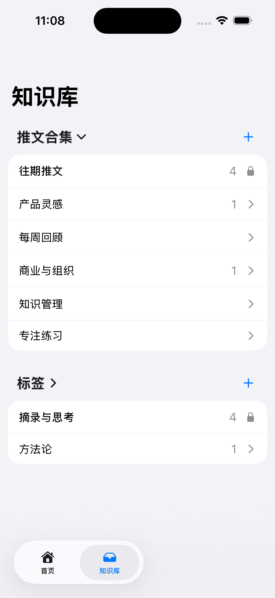
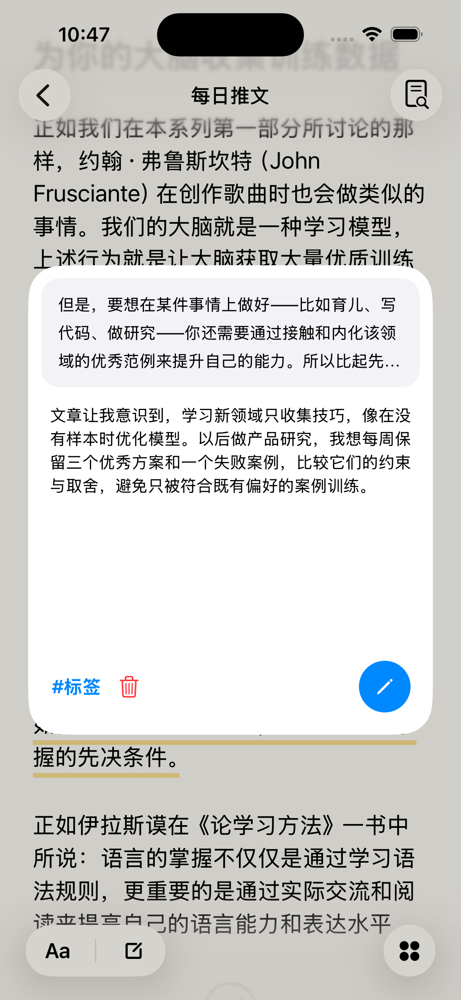
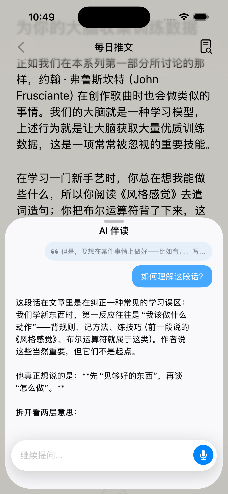
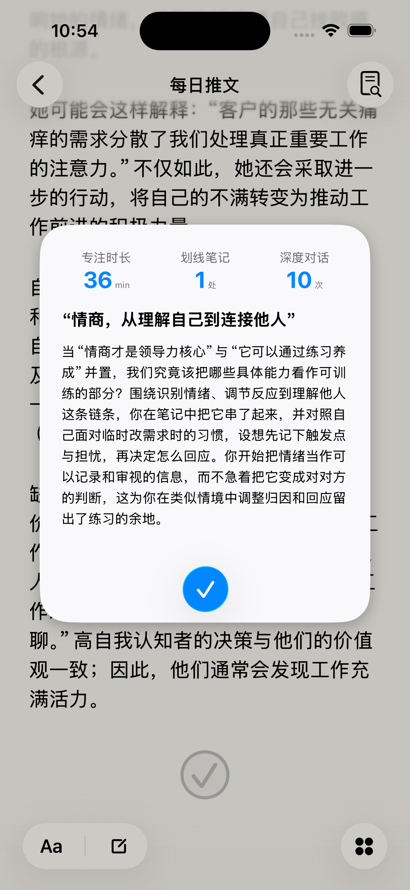
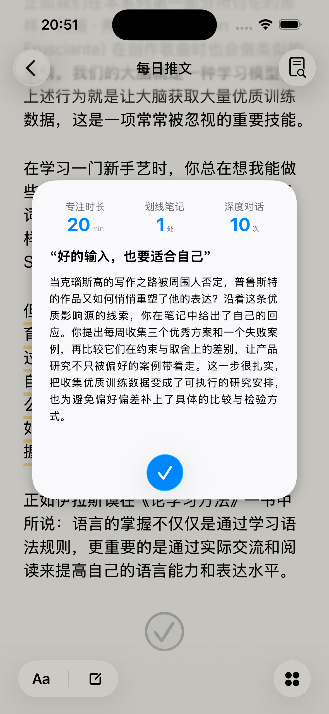
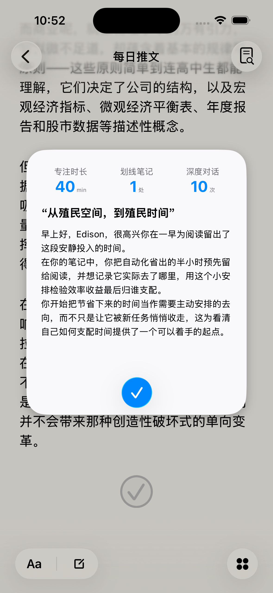

# Deep Reading · 深度阅读

## 产品定位
本产品面向信息过载环境下，希望持续学习却面临优质内容难筛选、深度阅读理解门槛高、阅读收获不易感知等问题的用户，提供每日精选文章、AI伴读、个人知识库与个性化阅读认可报告，串联“内容发现—阅读理解—知识沉淀—读后认可”的核心用户路径。通过有具体阅读痕迹支撑的赞赏反馈，让用户的投入与思考被看见，并形成便于展示与分享的阅读成果。

## 产品愿景
让深度阅读成为更容易开始、理解和持续的日常习惯。通过精选内容降低筛选负担，通过AI伴读帮助用户理解难点，通过知识库积累可回顾、可调用的阅读资产，再以个性化认可反馈，让用户感受到投入的意义与思考的价值。希望用户不仅愿意收藏内容，也愿意真正读进去、留下自己的思考，并持续阅读与分享。

**SwiftUI / UIKit · Supabase · DeepSeek Flash**

  
  
  

  
  
  

**操作演示 · 1 分 5 秒**

https://github.com/user-attachments/assets/9baaaef5-bee8-4b6c-85e1-0c8107bdf5e6

## 核心功能模块

Deep Reading 围绕一条完整的用户核心路径构建：打开文章，选中文字留下笔记，围绕原文向 AI 追问，完成阅读后生成认可报告，再从知识库回看积累的阅读资产。

| 功能模块 | 核心体验 |
| --- | --- |
| 原生阅读器 | 文本选区、划线、就近操作菜单、滚动导航与原文定位 |
| 划线与笔记 | 纯划线、关联型笔记、独立型笔记统一为阅读资产；卡片支持查看、编辑及标签管理 |
| 知识库 | 按合集组织文章、按标签查阅资产；从汇总条目打开资产卡片或返回原文位置 |
| AI 伴读 | 从阅读器直接提问，或携带选区/已有划线引用进入对话；支持流式回复、停止与重试 |
| AI 阅读报告 | 完成阅读后，基于当前文章与用户笔记生成个性化认可报告，呈现具体思考及其值得肯定之处 |

## 技术实现

- **客户端：** SwiftUI 组织页面，UIKit / TextKit 实现文本选区、划线、资产卡片及部分原生玻璃控件；Coordinator 管理页面状态，Repository 封装数据访问。
- **数据与身份：** Supabase Auth 建立匿名会话；PostgreSQL 存储文章、阅读资产与标签，RLS 隔离用户数据，RPC 处理受控写入。
- **AI 服务：** TypeScript Edge Functions 在服务端读取上下文并调用 `deepseek-flash`；AI 伴读采用 SSE 流式传输，阅读报告采用结构化分析与提示词组件组装。

实现细节见 [技术架构](docs/ARCHITECTURE.md)。

## 本地运行

本地运行需要 macOS、支持 iOS 26 SDK 的 Xcode，以及本机 Supabase 环境。AI 功能需自行配置 DeepSeek API Key。完整步骤见 [运行说明](docs/SETUP.md)。
